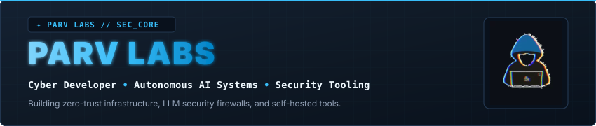
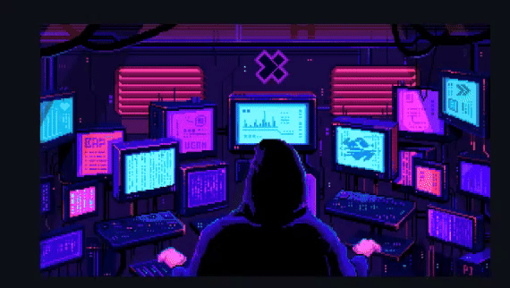
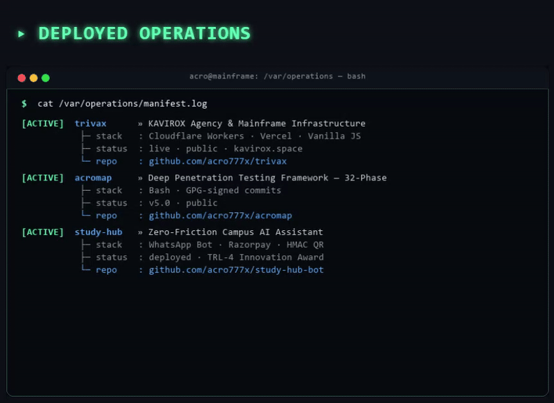
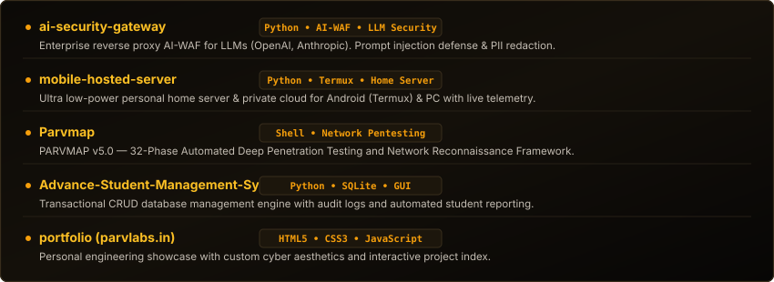
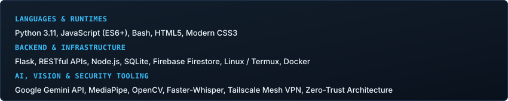
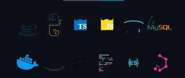
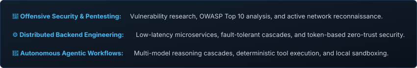
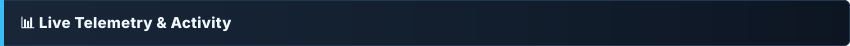

 

  

 

 

  

 

  <a href="https://github.com/parvlabs"><strong>⚡ PARV v5.0 Holographic AI</strong></a> &nbsp;&bull;&nbsp;
  <a href="https://github.com/parvlabs/CyberPath"><strong>🛡️ CyberPath AI Ecosystem</strong></a> &nbsp;&bull;&nbsp;
  <a href="https://github.com/parvlabs/Parvmap"><strong>🎯 Parvmap Pentest Suite</strong></a> &nbsp;&bull;&nbsp;
  <a href="https://github.com/parvlabs/Mobile-Self-Hosted-Server"><strong>📱 Mobile Self-Hosted Server</strong></a>

 

  
<strong>System Architecture & Key Highlights ▾</strong>

   

* **PARV v5.0 (Autonomous 3D Holographic AI Assistant):** Audio-reactive visualizer and 3D disc interface rendered via Three.js WebGL inside PyQt6; real-time MediaPipe/OpenCV gesture tracking; hi-IN-MadhurNeural voice synthesis; multi-provider cascade (Gemini, DeepSeek, OpenAI); PyAutoGUI computer automation; 4-tier SQLite memory RAG; 5-layer zero-trust hardening.
* **CyberPath (AI Cybersecurity Assessment Ecosystem):** Cyber DNA Radar evaluating 48 granular proficiencies across 8 core security domains; role gap engine matching 9 career tracks; generative dynamic MCQ scaling; 5-model cascade failover; zero-dependency SPA with client-side isolation.
* **Parvmap (Automated Deep Penetration Testing Framework):** 32-phase automated reconnaissance and vulnerability scanning engine; intelligent port discovery, service enumeration, and CVE correlation; modular bash architecture with GPG-signed audit trails.
* **Mobile Self-Hosted Server (Hardened Android Micro-Server):** Live telemetry for CPU, RAM, battery temp, and bandwidth; secure token-authenticated web file manager; path-traversal mitigation; mesh VPN routing via Tailscale.

 

 
 

 

  

 

  <picture>
    <source media="(prefers-color-scheme: dark)" srcset="https://skillicons.dev/icons?i=python,js,html,css,react,nodejs,bash,linux,git,docker&theme=dark">
    <source media="(prefers-color-scheme: light)" srcset="https://skillicons.dev/icons?i=python,js,html,css,react,nodejs,bash,linux,git,docker&theme=light">
    
  </picture>

 

 
 

<!-- Activity Line Graph -->

  <picture>
    <source media="(prefers-color-scheme: dark)" srcset="https://github-readme-activity-graph.vercel.app/graph?username=parvlabs&bg_color=0f1925&color=38bdf8&line=7dd3fc&point=f0f9ff&area=true&hide_border=true">
    <source media="(prefers-color-scheme: light)" srcset="https://github-readme-activity-graph.vercel.app/graph?username=parvlabs&bg_color=fbfaf8&color=d97706&line=b45309&point=1c1917&area=true&hide_border=true">
    
  </picture>

 

<!-- Stats & Top Languages Cards -->

  <picture>
    <source media="(prefers-color-scheme: dark)" srcset="https://github-readme-stats.vercel.app/api?username=parvlabs&show_icons=true&theme=dark&bg_color=0f1925&title_color=38bdf8&text_color=cbd5e1&icon_color=38bdf8&border_color=22364f&hide_border=false&include_all_commits=true">
    <source media="(prefers-color-scheme: light)" srcset="https://github-readme-stats.vercel.app/api?username=parvlabs&show_icons=true&theme=default&bg_color=fbfaf8&title_color=b45309&text_color=57534e&icon_color=d97706&border_color=e3ded5&hide_border=false&include_all_commits=true">
    
  </picture>
  <picture>
    <source media="(prefers-color-scheme: dark)" srcset="https://github-readme-stats.vercel.app/api/top-langs/?username=parvlabs&layout=compact&theme=dark&bg_color=0f1925&title_color=38bdf8&text_color=cbd5e1&border_color=22364f&hide_border=false">
    <source media="(prefers-color-scheme: light)" srcset="https://github-readme-stats.vercel.app/api/top-langs/?username=parvlabs&layout=compact&theme=default&bg_color=fbfaf8&title_color=b45309&text_color=57534e&border_color=e3ded5&hide_border=false">
    
  </picture>

 

<!-- Contribution Grid Snake Animation -->

  <picture>
    <source media="(prefers-color-scheme: dark)" srcset="https://raw.githubusercontent.com/parvlabs/parvlabs/output/github-contribution-grid-snake-dark.svg">
    <source media="(prefers-color-scheme: light)" srcset="https://raw.githubusercontent.com/parvlabs/parvlabs/output/github-contribution-grid-snake.svg">
    
  </picture>

 

  
  &nbsp;
  
  &nbsp;
  
  &nbsp;
  

